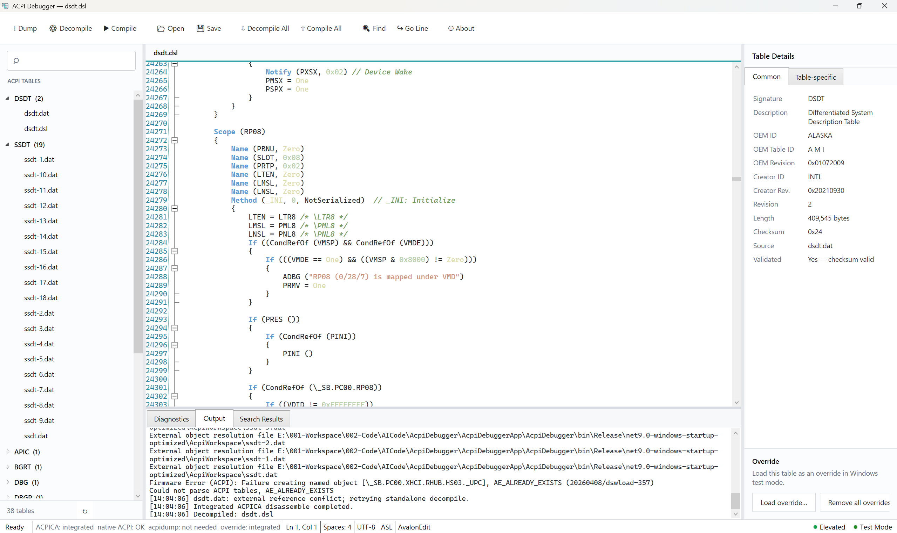

# ACPI Debugger

[English](README.md) | 中文


[](https://github.com/uefibin/AcpiDebugger/stargazers)


> ⭐ 如果 ACPI Debugger 对你的 BIOS/UEFI 开发有帮助，欢迎 Star 支持项目。

ACPI Debugger 是一款面向 BIOS/UEFI 工程师的 Windows ACPI 开发与调试工具，提供 ACPI 表导出、AML 反编译、ASL 编辑、AML 编译及 Windows ACPI Override 加载的一站式工作流。



## 功能特点

- 浏览 ACPI Table（DSDT / SSDT）
- AML 反编译为 ASL
- ASL 代码编辑与语法高亮
- 内置 ACPICA 编译/反编译、诊断解析和错误定位
- 批量反编译 / 编译及整体进度显示
- ACPI Table 信息查看
- 在 Table Details 面板解析并显示 BGRT、APIC、FADT、HPET、MCFG、TPM2、调试、性能、安全及根表专有字段
- Windows ACPI Override 加载
- 管理员权限与 Test Mode 检测
- 响应式 WPF 界面

## 使用流程

```text
Dump ACPI Tables
        ↓
Decompile AML
        ↓
修改 ASL
        ↓
Compile AML
        ↓
Load Override
```

> 加载 Override 会修改 Windows 的 ACPI 配置，请仅在测试机器上操作，并提前准备系统恢复方案。

## ACPICA 集成与外部依赖

| 组件 | 来源 | 协议 | 用途 |
|---|---|---|---|
| ACPICA native backend | [open-acpica/acpica](https://github.com/open-acpica/acpica) | BSD-3-Clause / GPL-2.0-only | 进程内 AML 反编译、ASL 编译 | `third_party/acpica` |

Dump 使用 Windows 原生 ACPI 接口和 `HKLM\HARDWARE\ACPI` 注册表数据，完整读取 DSDT、FACS、FADT/XSDT 以及各个 SSDT 实例，不依赖 `acpidump.exe`。AML 反编译和 ASL 编译由项目内置的 ACPICA native backend 完成。Load Override 使用内置注册表差分加载器，不再依赖微软 `asl.exe`；写入前会验证修改表和实时固件表。

目录结构：

```text
AcpiDebuggerApp/
├─ AcpiDebugger/
│  └─ AcpiDebugger.csproj
third_party/
└─ acpica/              # ACPICA 源码与 native DLL 工程
```

## 开源组件

| 组件 | 协议 | 用途 |
|---|---|---|
| [ACPICA](https://github.com/open-acpica/acpica) | BSD-3-Clause / GPL-2.0-only | 内置 ACPI ASL/AML 编译与反编译后端 |
| [AvalonEdit](https://github.com/icsharpcode/AvalonEdit) | MIT | ASL 代码编辑器 |
| [.NET / WPF](https://github.com/dotnet/wpf) | MIT | 应用框架 |

## 编译

环境要求：

- Windows 10 或 Windows 11
- .NET 9 SDK
- Visual Studio 2022 或兼容的构建环境

在仓库根目录执行：

```powershell
dotnet restore .\AcpiDebuggerApp\AcpiDebugger\AcpiDebugger.csproj
msbuild .\third_party\acpica\integration\AcpiCompilerHost.vcxproj /p:Configuration=Release /p:Platform=x64
dotnet build .\AcpiDebuggerApp\AcpiDebugger\AcpiDebugger.csproj -c Release
```

ARM64 测试构建将 `Platform` 改为 `ARM64`，并使用 `dotnet build -r win-arm64`。

导出 ACPI 表或加载 Override 时，请以管理员身份运行程序。

## 作者

**bin**

- 博客：[https://ay123.net](https://ay123.net)
- 微信公众号：**UEFI那点事**

## 开源协议

本项目采用 [MIT License](LICENSE)。第三方工具和组件仍遵循各自的许可证。
