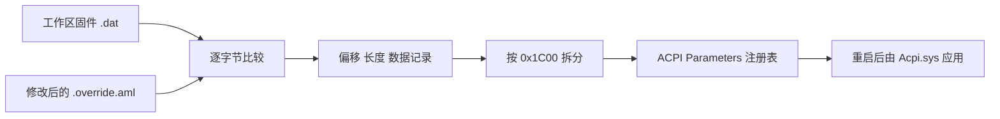

# Microsoft ASL `/loadtable` 格式分析

> 安全提示：不要将完整 AML 直接写入 Override 注册表，也不要把未经启动验证的表部署为 `acpitabl.dat`。错误表可能触发 `ACPI_BIOS_ERROR`。

## 结论

Microsoft `asl.exe /loadtable` 使用固件原表和修改表生成二进制差分记录，再写入 ACPI Parameters 注册表。AcpiDebugger 已按这一格式实现内置加载，不再执行外部 `asl.exe`。

## Evidence → Finding → Path

| Evidence | Finding | Implementation path |
|---|---|---|
| `asl.exe` 字符串 `System\\CurrentControlSet\\Services\\ACPI\\Parameters\\%c%c%c%c\\%s\\%s\\%.8x`，引用于 `0x14000BA47` | 注册表层级为 Signature/OEM ID/OEM Table ID/OEM Revision | `AcpiLoader.StageRegistryDelta` |
| `0x14000B9B2`、`0x14000B9F5` 将空格 `0x20` 改成下划线 `0x5F`；`HKLM\HARDWARE\ACPI` 实际路径包含尾部填充对应的 `_` | 注册表标识符必须把固定宽度字段中的全部空格替换为 `_`，包括尾部空格 | `ReadAcpiRegistryId` |
| Frida 将 `asl.exe` 的目标分支重定向到 HKCU 后取得真实输出：只改 revision/checksum 的 409545 字节 DSDT 仍产生 58 个值 | revision+1 的 Override 使用完整替换流：先 `{newLength, 0}`，再从 offset 0 写入整张表 | `BuildRegistryDeltaValues` |
| `0x14000B67C` 使用 `RegSetValueExA(..., REG_BINARY, ...)`，值名为 `%08x` | 差分值命名为 `00000000`、`00000001`…… | `StageRegistryDelta` |
| 单值缓冲区大小为 `0x1C00`，新记录头不得晚于 `0x1B80` 开始 | 大差分必须按微软实现的边界拆分成多个 REG_BINARY 值 | `BuildRegistryDeltaValues` |
| `0x14000B531` 写入 DWORD `Action=0` | revision key 需要 Action 控制值 | `StageRegistryDelta` |
| `0x14000BB90` 检查签名、表长和 checksum | 加载前必须验证合法 ACPI 表 | `PrepareOverrideTable` / `ReadAcpiTableIdentity` |
| 微软公开文档要求加载表版本高于 BIOS 原表；目标机原表与首次失败镜像均为 `0x01072009` | Override 表头和注册表 revision key 必须使用固件 OEM Revision + 1 | `PrepareOverrideTable` / `ReadLiveFirmwareBaseTable` |

## 数据流

## 安全边界

- 必须先运行 Dump，工作区中必须存在身份匹配的原始 `.dat`。
- 找不到固件基表时拒绝加载，不能退化为完整表写入。
- 加载仍要求管理员权限、Test Signing，并需要重启。
- 构建验证不能代替目标机重启验证；首次测试应确保能够进入 WinRE。

## 复现信息

- 分析目标：随项目保存的 Microsoft `asl.exe` x64 版本。
- 工具：radare2 6.1.8，只进行静态分析，未执行 `/loadtable`；2026-09-22 再次核对差分合并和 `0x1B80`/`0x1C00` 边界。
- 关键函数：`0x14000B414`（差分生成）、`0x14000B5AC`（记录编码）、`0x14000B67C`（注册表写值）、`0x14000B928`（路径生成）、`0x14000BB90`（表验证）。
